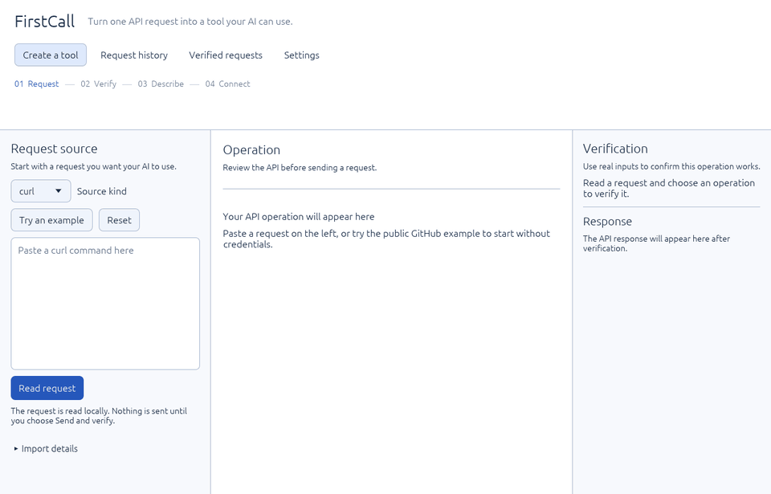

# FirstCall

Turn an API request into a tool your AI client can actually call.



Paste a request, send it once with real inputs, describe what it does, and export
it as a local MCP tool. The app includes the command-line runner that serves the
tool, so there is no generated code to build and no npm or Python setup. Tokens
you save stay in your OS keychain.

## Make your first tool

1. Download FirstCall from the [latest release](https://github.com/rad1092/firstcall/releases/latest).
   On a Mac, move FirstCall.app to Applications.
2. Choose **Create a tool** and paste a request, or choose **Try an example** for a
   public GitHub lookup that needs no token.
3. Choose **Read request**, check the operation, and fill in its inputs. Tokens go
   under **Auth inputs** and are saved per API.
4. Choose **Send and verify**. FirstCall sends the real request and shows the
   response. If it fails, the banner says why and what to try next.
5. Choose **Continue to MCP tool**. Name the tool, say when the AI should use it,
   and describe each input.
6. Choose **Export MCP package**, then **Copy connection configuration** and add it
   to your AI client's MCP settings.

Every tool call makes a new request to the API. Responses come back as
structured JSON with secrets redacted.

## Bring requests from where you already have them

| Source                       | What to paste or open                         |
| ---------------------------- | --------------------------------------------- |
| curl                         | A `curl` command, for example from API docs   |
| OpenAPI                      | A YAML or JSON spec; pick one operation       |
| HAR                          | Requests saved from your browser's DevTools   |
| Postman, Bruno               | An exported collection or a `.bru` file       |
| `.http`, Hurl                | Files from VS Code REST Client, JetBrains, Hurl |

A HAR file is the quickest way to turn something you just did in the browser into
a tool: open DevTools, save the network log, and pick the request.

## Many tools, one server

Each export is a folder in FirstCall's data folder. **Copy configuration for all
exported tools** gives you one MCP server entry that serves all of them, instead
of one server per tool. From the command line:

```sh
firstcall-cli connect --toolbox "<FirstCall data folder>/exports"
firstcall-cli serve --package ./find_user --package ./find_repo
```

## Tokens

Tokens you enter in FirstCall are saved in the OS keychain (macOS Keychain,
Windows Credential Manager, or the Linux kernel keyring), separately for each
API. Exported tools read the token saved for their API, so you enter it once.

To override a saved token, set the environment variable listed in the
connection configuration. When one server serves tools for different APIs, each
tool's variable ends in its name, for example `FIRSTCALL_BEARER_TOKEN__FIND_REPO`,
so one API's token is never sent to another.

## What it allows

- GET and HEAD only, unless you allow write requests for a tool when exporting.
- Only the endpoint the tool was exported for. Redirects to other endpoints are not followed.
- A 30-second timeout and 256 KiB per response. Oversized or malformed JSON is an
  error, not a partial answer.

FirstCall has no cloud backend. Request history and verified requests are stored
in a local SQLite database.

## What's in an exported tool

- `tool.json`: the tool's name, purpose and input schema
- `recipe.yaml`: the request template and its inputs
- `policy.json`: the one endpoint and method it may call
- `verified.lock.json`, `package.manifest.json`: verification and integrity records
- `client-config.json`: the MCP server entry, with empty credential variables

## Command line

The same `firstcall-cli` verifies requests, inspects and imports packages, and
serves tools. See [CLI usage](docs/cli-lifecycle.md).

If you move the app or a tool folder, rebuild the connection from the new location:

```sh
/path/to/firstcall-cli connect --package /path/to/tool
```

FirstCall is built for the handful of API calls you actually use, each checked
by hand before an AI can call it. To expose every operation of a large OpenAPI
spec at once, a generator such as FastMCP fits better; see the
[comparison](docs/OPENAPI-COMPARISON.md).

## Build from source

Rust stable. `cargo build --release` builds the app and the CLI. See
[Build surfaces](docs/build-surfaces.md) and [Support boundaries](docs/support-boundaries.md).

## Limitations

- On Linux the kernel keyring forgets saved tokens when you log out. Use environment
  variables there if you need them to persist.
- On macOS, the first time an exported tool reads a saved token, macOS asks whether
  `firstcall-cli` may use it. Choose Always Allow.
- macOS may ask you to confirm the first launch of the app in System Settings,
  Privacy & Security.
